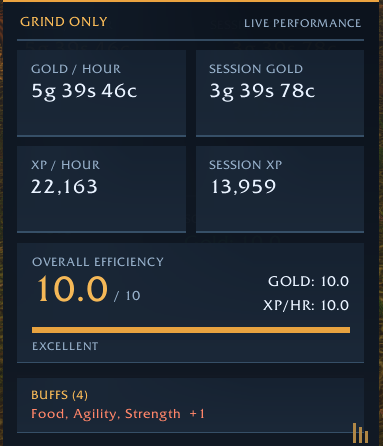
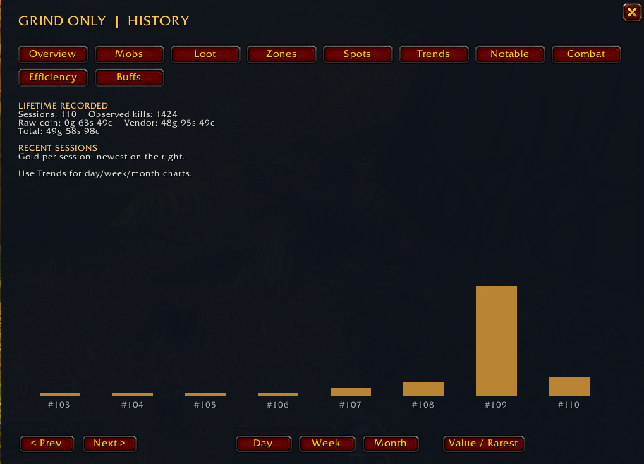
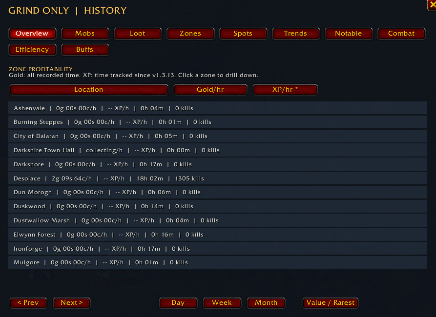
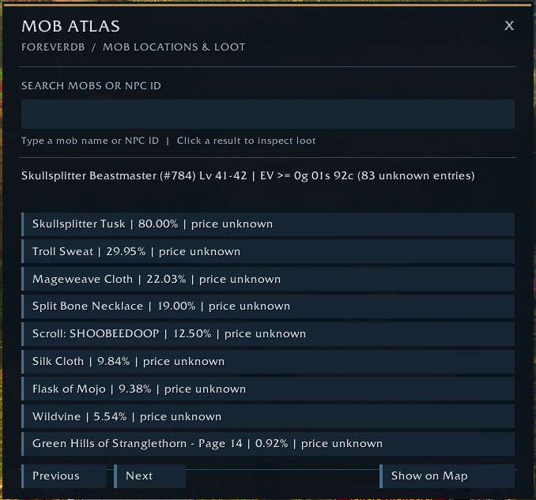
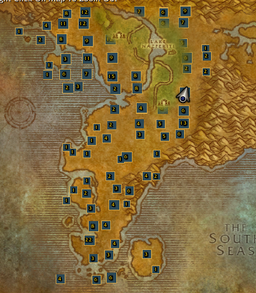

# Grind Only

A local grinding analytics addon for **World of Warcraft: Forever**. Track earnings, experience, buffs and farming history, and explore potential farming targets using ForeverDB.

**Baseline:** v1.3.19 (Phase 00 development snapshot; not yet a public release). Target client interface: 16001. English loot and buff messages are assumed.

[Installation](#installation) · [Features](#features-and-how-to-use-them) · [Screenshots](#screenshots) · [Commands](#commands) · [Feedback](#feedback-and-development)

  

## Grind smarter

Track your gold and XP in real time, compare farming locations, discover mob drops and keep your buffs active — all inside the game.

*Live dashboard from an earlier development build. Left-click the minimap icon to toggle it.*

## Installation

1. Close WoW Forever.
2. Before a stable release is published, download the repository ZIP from GitHub and use the inner `GrindOnly` folder. After a stable release is published, use [GrindOnly.zip from the latest release](https://github.com/smobcraft/GrindOnly/releases/latest/download/GrindOnly.zip).
3. Copy that folder into `World of Warcraft/_forever_/Interface/AddOns/` so `AddOns/GrindOnly/GrindOnly.toc` exists. Do not nest it twice.
4. For database features, download [ForeverDB by Fatedfr](https://www.curseforge.com/wow/addons/forever-db) separately. Extract its supplied addon folders into the same AddOns directory; enable ForeverDB on the character selection AddOns screen. The inspected reference version is 2026.11.23.41. The core tracker does not require it.
5. Restart WoW, enable Grind Only, log in and left-click the Grind Only coin icon on your minimap (or type `/wgf show`) to open the dashboard. Right-click the icon or type `/wgf stats` for analytics.

For upgrades, close the game and replace only the addon folder. Keep `WTF/Account/<account>/SavedVariables/GrindOnly.lua` and its backup. Never copy personal SavedVariables into this repository.

## Features and how to use them

| Feature | How to use |
| --- | --- |
| Live dashboard | Left-click the Grind Only minimap icon to toggle the dashboard, or type `/wgf show`; drag/resize the panel. Rolling 15-minute gold and XP rates, session totals, buff status and efficiency. |
| Overview | `/wgf stats` → Overview for session history. |
| Mobs | Stats → Mobs; select a row for observed kills, earnings and attributed drops. |
| Loot | Stats → Loot; select an item for recorded sources; hover for native item tooltip. |
| Zones | Stats → Zones; select a zone to drill into subzones and compare rates. Historical XP may be estimated. |
| Spots | Stats → Spots or `/wgf spots` for observed farming locations. |
| Trends | Stats → Trends; choose Day, Week or Month. |
| Notable | Stats → Notable; switch value/rarity sorting. |
| Combat | Stats → Combat for approximate target timing and gaps. |
| Efficiency | Stats → Efficiency or `/wgf eff`; compare gold and XP rates with comparable historical sessions. |
| Buffs | Stats → Buffs or `/wgf buffs`; configure tracked and custom buffs. |
| Explorer | Stats → Explorer; search by name or ID, select category, click results and page through details. Items, NPCs, quests, objects, zones and personal history. |
| Mob Atlas | `/goatlas <mob name>` to search; `/goatlas map` for map pins. Use map checkbox and level filters. |
| Notable loot | Hover a living NPC; native tooltip shows up to five selected drops when supported. |
| Predictive grinding | Hover a living NPC; estimated gold/hr and XP/hr. `/goatlas prediction detail` reveals assumptions and per-kill rates. |

## Screenshots

These are actual in-game screenshots from development builds; the current interface may differ slightly.

### Historical analytics

Review lifetime earnings and compare recent sessions.

### Zone profitability

Compare farming locations and drill down into subzones.

### Mob Atlas

Search mobs and explore their known locations with ForeverDB.

| Mob Atlas search | World map pins |
| --- | --- |
|  |  |

Explorer and predictive tooltip screenshots will be added when current captures are available.

## Commands

`/wgf` and `/grindonly` are aliases. No argument toggles the dashboard. Subcommands: `show`, `hide`, `stats`, `buffs`, `spots`, `eff` (or `efficiency`), `mob <row number>`, `reset` (starts a new session, not a history wipe), `debug` (cast diagnostics).

The separate Discord feedback bot accepts reports through commands and an own-message context menu with an editable preview. Supported image attachments are linked from Discord and may expire. `/approve <issue number>` records a content-revision approval and adds an `ai-ready` label; it does not authorize automated code execution. Autonomous issue-to-PR work is deferred. See [bot setup and security details](tools/discord-bot/README.md).

`/goatlas` opens the atlas; `/goatlas <name>` searches; `/goatlas map` opens the map; `/goatlas level <min> <max>` filters map levels; `/goatlas tooltip on|off|toggle` controls notable loot; `/goatlas prediction on|off|detail|compact` controls forecasts; `/goatlas debug` prints database/map/hook diagnostics.

## Understanding the numbers

Gold is looted coin plus vendor sell value, not auction-house profit. Mailbox rewards are excluded; other chat loot may be counted. XP tracking measures character XP changes, including quests. Kills are target-based and can miss AoE or untargeted deaths. Efficiency needs at least three comparable historical sessions of five minutes or more; live scoring begins after five minutes. Predictions use historical session throughput, database loot probabilities and a provisional solo XP formula with a rested-pool cap. They are estimates, not guaranteed rewards. Missing history or prices can prevent forecasts. See [known issues](docs/KNOWN_ISSUES.md).

## Feedback and development

Use [GitHub Issues](https://github.com/smobcraft/GrindOnly/issues) to report bugs or suggest improvements once the repository is accessible. Include addon/client versions, steps, expected and actual behavior, and sanitized Lua errors. The maintainer reports that the Phase 03A Discord feedback bot is running and the slash commands, issue creation and issue status lookup have been verified; this session has not performed live Discord or GitHub verification. See [CONTRIBUTING](CONTRIBUTING.md), [roadmap](ROADMAP.md), [architecture](docs/ARCHITECTURE.md), and [Phase 03B documentation](docs/phases/PHASE-03-DISCORD.md).

All addon tracking is local to WoW SavedVariables; addon telemetry is not sent externally. The separate Discord bot is a maintainer-operated feedback workflow that explicitly posts public GitHub issues only after a user submits a feedback modal. ForeverDB is a separate project and is not bundled. Distribution license and remaining asset provenance must be approved before public publication; no open-source license is granted by this draft.
